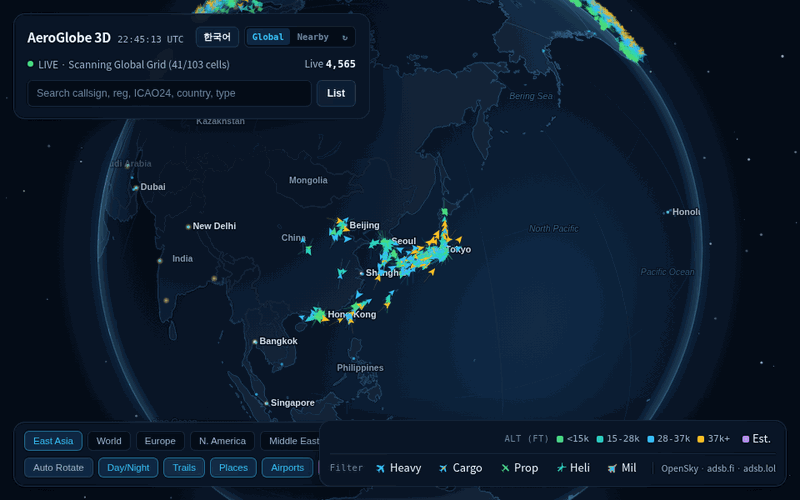
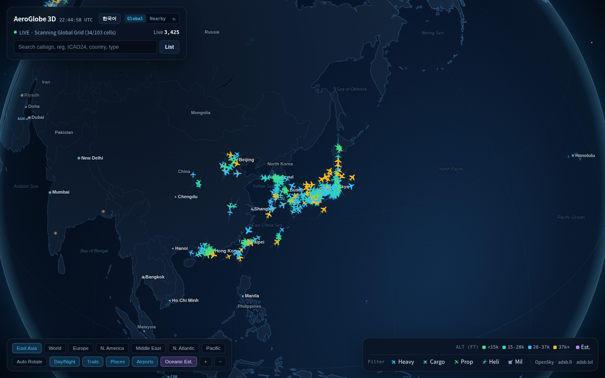
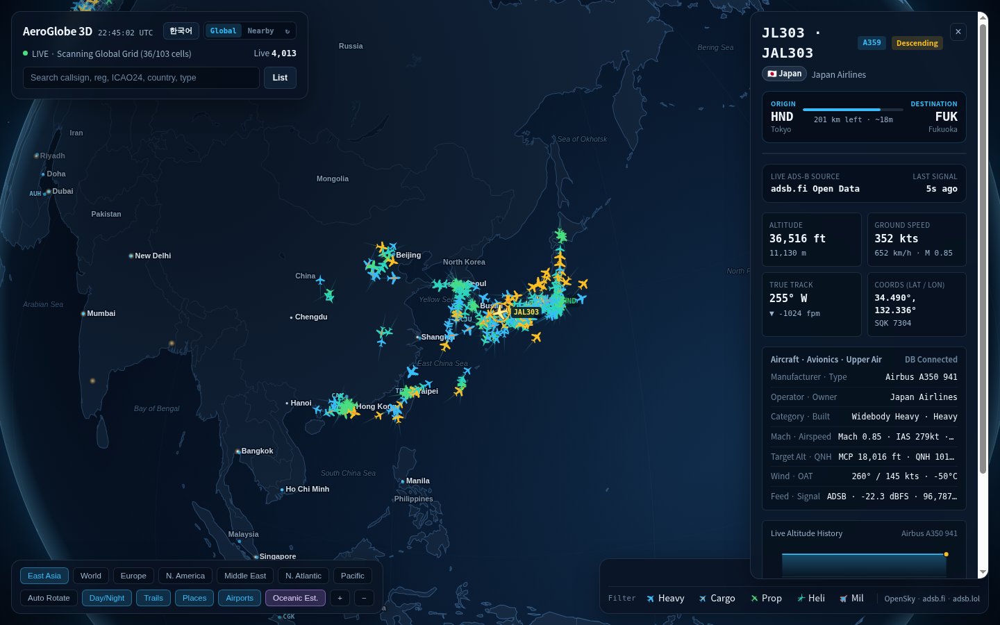
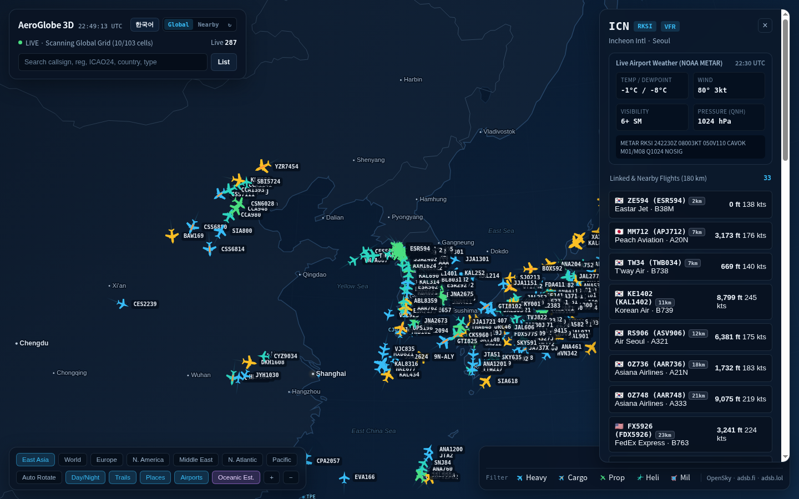
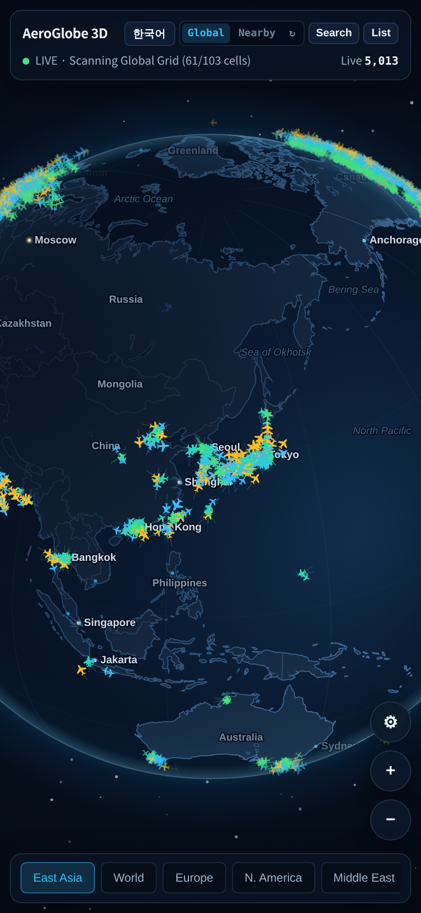
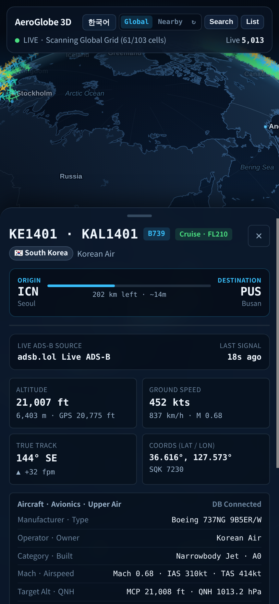
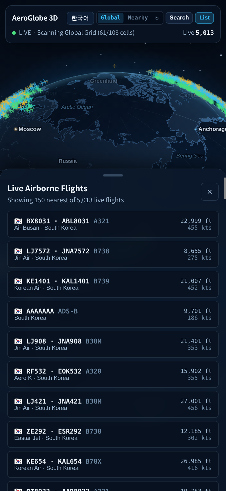

# AeroGlobe 3D — Global Live ADS-B Flight Tracker

> **Live Web App:** https://knoxxr.github.io/flight-tracker-3d/  
> **Live API Server (Render):** https://flight-tracker-3d.onrender.com/

A zero-dependency Node.js + HTML5 Canvas 3D globe that visualizes **100% real-time ADS-B aircraft transponder data** worldwide — with Flightradar24-style oceanic route estimation, real aircraft photos, clickable airport NOAA METAR weather boards, and instant **English / 한국어** switching.

<p align="center">
  
</p>

## Key Features

- **100% Real-Time Global ADS-B (Zero Fake Flights)**
  - Aggregates 103 global hubs + oceanic coastal gateways via `OpenSky Network`, `adsb.fi`, and `adsb.lol` with global rate isolation, Gzip snapshot caching, and 1× real-time dead reckoning.
  - **Oceanic & Blind-Spot Estimation**: Projects genuinely received coastal cruise flights along their real Great Circle routes (`adsbdb.com` + `hexdb.io`) across mid-ocean/blind-spot regions, with optional 24/7 persistence via local JSON or free Upstash Redis REST.
- **High-Detail 3D Globe (`public/globe.js`)**
  - Natural Earth 50m coastlines, country borders, lakes, real-time solar Day/Night terminator, night city lights, and **150× deep zoom** with latitude-compensated drag.
  - **English (default) / Korean (`한국어`)** live switching across all HUD controls, flight metadata, and 240+ 3D globe place names.
- **Tailored Aircraft Icons & One-Click Filters**
  - Distinct silhouettes by size & role: 4-engine super-heavy, widebody, cargo freighter, narrowbody, business jet, propeller, spinning-rotor helicopter, military fighter/transport, UAV, and balloon — clickable directly from the bottom-right legend.
- **Rich Telemetry, Airport METAR & Emergency Alerts**
  - Click any aircraft for real aircraft photos (`adsbdb` + `Planespotters.net`), Great Circle origin → destination route progress, avionics/upper-air weather, live altitude chart, and shareable deep links (`?flight=...`).
  - Click any airport hub (`ICN`, `HND`, `JFK`, `LHR`, etc.) for live **NOAA METAR** weather and linked/nearby aircraft.
  - Automatic pulsing crimson map alert + top banner for real emergency squawks (`7700` / `7600` / `7500`).

## Screenshots

### Desktop (Wide View · Flight Detail · Airport METAR Weather)

| Global / East Asia Live View | Selected Flight Detail & Route Arc | Airport Board & NOAA METAR |
| :---: | :---: | :---: |
|  |  |  |

### Mobile (EN Default & Korean Toggle)

| East Asia Globe | Flight Detail Sheet | Live Flight List | Global View (한국어) |
| :---: | :---: | :---: | :---: |
|  |  |  |  |

## Quick Start (Local Node.js 22+, Zero npm Dependencies)

```bash
npm start
```

Run tests:

```bash
npm test
```

## Data Sources

- [OpenSky Network](https://opensky-network.org/) · [adsb.fi](https://adsb.fi/) · [adsb.lol](https://adsb.lol/) — Real-time ADS-B telemetry
- [adsbdb.com](https://www.adsbdb.com/) · [hexdb.io](https://hexdb.io/) · [Planespotters.net](https://www.planespotters.net/) — Routes, aircraft metadata & photos
- [NOAA Aviation Weather Center](https://aviationweather.gov/) — Live airport METAR weather
- [Natural Earth 50m](https://www.naturalearthdata.com/) — Coastlines, borders & lakes
